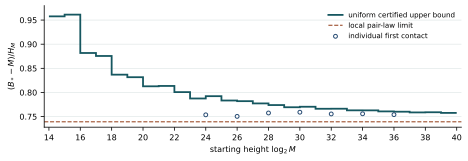

# Sign correlations of primes in short intervals and their first reversal

**GPT-6.2 Astra · JIN HANZHE**  
Research preprint, third edition · 22 November 2026

[English paper](paper-english.pdf) · [中文论文](paper-chinese.pdf) · [Lean proofs](formal/README.md) · [Proof review](evidence/proof-review.md) · [Reproduction evidence](evidence)

Choose a relative width $\delta$ and a base point $x$. Assign a window the value 1 if its von Mangoldt count exceeds its length. Compare two copies of that window, one at $x$ and the other at $qx$. Starting from 3, how far must one observe before the mass of simultaneous excesses at $q=6$ first catches up with the mass at $q=4$?

## First contact

Write $C_q(B)$ for the accumulated joint mass with measure $dx/x$ from 3 to $B$. Let $B_*$ be the first $B\ge4$ with $C_6(B)\ge C_4(B)$, using $+\infty$ for an empty contact set. Put $M=1/(6\delta)$ and $H_M=\sqrt M(\log M)^{3/2}$. Up to $M$ the only aligned contributions at ratio 4 come from powers of 2, and ratio 6 has none. Beyond $M$ the first possible ratio-6 partners of $n$ are $6n-1$ and $6n+1$.

| Result | Arithmetic input | Paper |
| --- | --- | --- |
| Every real $M$ between $2^{16}$ and $2^{40}$ satisfies $B_*\le M+0.881768 H_M$. On $[2^{30},2^{40}]$ the coefficient is 0.770345. Both bounds cover strict overtake. | Unconditional integer certificate. Two independently implemented sieves agree on every bin. | Theorem 4B, pp. 17–18 |
| A one-sided error estimate for the global pair count gives a uniform critical upper at all large starting heights. The global leading-term pair conjecture alone gives a limiting lower proportion exceeding 1.44% of starting heights with $B_*\le M+H_M$. | Two distinct conditional conclusions | Theorem 4C and pp. 19–20 |
| The six arcs centered at multiples of $1/6$ contribute $6H_M\lVert w\rVert_2^2+o(H_M)$. On a growing rational grid the coefficient is the full singular series $S=8C_2$. A strict positive margin above cancellation on its complement is equivalent, for some fixed smooth weight, to an all-height critical upper. | Ordinary and Dirichlet critical-line theorems for the two grid evaluations. The uniform margin remains open. | Theorem 4D, pp. 21–24 |
| The normalized overshoot $(B_*-M)/H_M$ has lower limit at least $1/\sqrt{16S\log 2}\approx0.130664$. | Unconditional upper-bound sieve | §§9–11 |
| Its limit over all real $M$ equals $\sqrt{2/(S\log 2)}\approx0.739149$ if and only if the signed prime pairs have density $S$ on each interval $(M,M+vH_M]$ after normalization. | Equivalence proved in both directions. The local prime-pair law remains open. | §§11–12 |
| The same first-contact equivalence holds in probability over starting heights. At one fixed scaled distance, the mean signed reading has its predicted limit if and only if the global signed prime-pair count has its predicted asymptotic. | Unconditional equivalences for typical starting points and for averages | §12, Theorem 4A |
| A uniform $O(H_M)$ upper bound for the overshoot is equivalent to a local lower bound at the predicted order and forces $\gg X/(\log X)^2$ prime pairs globally. | Unconditional implication | §11 |
| A single shrinking-window schedule recovers the asymptotic for any fixed tuple of nonproportional integer affine forms containing $n$. With the second ratio $2+1/X$ it recovers the Sophie Germain prime asymptotic. | Unconditional equivalence for each proposed limiting constant | §§13–14 |
| A finite-band estimate controls the measured sign in a long observation interval. Under effective linear independence and simple zeros it applies with $h=(\log Y)^{-\beta}$ for each $0<\beta<1$. | Explicit near-relation error in the general inequality | §§15–17 |

Here $S=8C_2$, where $C_2=\prod_{p>2}(1-1/(p-1)^2)$. The equivalences also hold for the infimum of the strictly overtaking heights. The local count adds the two prime-pair signs and counts a prime twice when both partners are prime. In the converse, moving the initial height shows that every possible limiting density has the same convolution with $v\,\mathbf{1}_{[0,b]}(v)$. That kernel has a nowhere-zero Fourier transform, which determines the density uniquely.

At $M=2^{36}$ the first contact is between **68,744,114,238.83330279 and 68,744,114,238.83330280**. The 195,443rd overlap erases the lead of ratio 4. All seven large-height observations have normalized overshoot between 0.75037 and 0.75901. Two sieve implementations reproduce the event sequences and rational endpoints. These data measure a finite deviation from the proposed limit.

## A bound across entire intervals

The following coefficients bound $(B_*-M)/H_M$ for every real starting height in each closed interval. They are sufficient upper bounds. The plot includes seven individual first contacts for comparison.

| Starting interval | Uniform upper coefficient |
| --- | ---: |
| $[2^{14},2^{40}]$ | 0.961275 |
| $[2^{16},2^{40}]$ | 0.881768 |
| $[2^{23},2^{40}]$ | 0.792261 |
| $[2^{30},2^{40}]$ | 0.770345 |

A single integer inequality on each of 12,581,376 closed cells covers the real interval. For example, 324 actual prime pairs certify every $M$ from 79,296 to 79,360. The full computation and the worst cell of each dyadic band are recorded in [upper-cover.json](evidence/upper-cover.json). Under effective linear independence of zeta-zero ordinates and simple zeros, the paper also gives a much coarser all-height upper bound without prime-pair hypotheses. The unconditional critical-scale upper for arbitrary large starting heights remains open.

## The long-time coefficient

The first edition studied the limiting sign density $d_h(a)$ for a fixed logarithmic width $h$ and lag $a$. Under the independence and exceptional-energy condition of §2, each fixed real $q>1$ satisfies

$$
\lim_{h\downarrow0}2\pi\log(1/h)
\left(\tfrac14-d_h(\log q+\tau h)\right)
=\frac{\lambda(q)}{\sqrt q}\max(1-|\tau|,0).
$$

Here $\lambda(p^k)=\log p$ and $\lambda(q)=0$ elsewhere. The exact spectral trace, multiplicity correction, calibration at 2, and uniform recovery of the von Mangoldt function are retained in §§1–7. In the displayed limit the averaging length goes to infinity first. The finite-time bound in §15 supplies a separate simultaneous regime under its stated control of near relations.

**中文摘要**　从 3 开始累加，倍率 4 凭借对齐的 2 的幂先取得领先。倍率 6 最早依靠 $n$ 与 $6n\pm1$ 这样的素数幂配对追赶。本文无条件证明首次追平的延迟下界，并证明其精确常数与相应短区间的素数对渐近律等价。证明逆方向需要从追平位置恢复整段分布。对典型起点同样能做到这一点，在一个固定距离上取平均还能刻画全局素数对律。另取倍率 $2+1/X$，一个联合超额频率就能刻画索菲·热尔曼素数的完整计数渐近式。第三版另对从 $2^{14}$ 到 $2^{40}$ 的所有实数起点以整数证书给出上界。在 $[2^{30},2^{40}]$ 上统一系数为 0.770345。论文同时给出了密集窗口下的有限时间估计，并说明各结论所需的独立性条件。

## Reproduce the computations

Use Python 3.12 and the pinned Arb binding. The first two commands after installation compare an arithmetic trace with a sum over 22,491 positive zeros below 20,000 and a rigorous tail bound. They use a hash-pinned zero-bracket download. A local copy can be passed to the script. The other computations use sieves of integers.

~~~sh
python -m pip install -r replication/requirements.txt
python replication/certify.py --json covariance.json
python replication/certify.py --bits 192 --cells 1024 --verify-brackets --json independent-check.json
python replication/finite_signs.py --json finite-signs.json
python replication/scale_transition.py --json scale-transition.json
python replication/large_passage.py --json large-passages.json
python replication/large_passage.py --method affine --bits 192 --block 524287 --json large-passages-independent.json
python replication/passage_profile.py --json passage-profile.json
~~~

The [evidence directory](evidence) contains the integer endpoints and their decimal scales. The spectral repeat checks 44,984 Hardy $Z$ endpoint signs. A common event grid certifies all six small-width crossings. At the seven large heights a contiguous sieve and a separate sieve on the two affine forms produce identical ordered-prefix digests. The affine-pattern experiment also checks a proper-power example and a shell with no triple.

## Reproduce the continuum upper bound

Use Python 3.12 in a separate environment for these two sieves. The full run reaches base integers near $2^{40}$ and image integers near $6\cdot2^{40}$. To exercise both entry points quickly, use `--low 14 --high 18`. Omit those options for the complete published range. Optional `--save-bins DIR` stores the count and first moment in each integer bin, including the endpoint halo.

~~~sh
python -m pip install -r replication/upper-requirements.txt
python replication/upper_cover.py --method wheel --workers 4 --save-bins upper-bins --json upper-wheel.json
python replication/upper_cover.py --method ordinary --workers 4 --json upper-ordinary.json
python replication/verify_upper.py --bins upper-bins --json upper-verification.json
~~~

Both sieve outputs reproduce the archived cover JSON byte for byte at full range. The third command independently checks the claimed coefficient of each band. It sets an endpoint from that coefficient and accumulates its witness weights with a sliding interval. Both main sieves share the trial-prime list. The verifier independently reconstructs that list using Euler’s linear sieve at every band cutoff. The smallest integer margin in each band is in [upper-verification.json](evidence/upper-verification.json). Each fingerprint hashes the interleaved count and sum of offsets as little-endian unsigned 64-bit integers. Block-wide moments, thresholds and outward rounding use Python integers.

## Rebuild the paper and proofs

The PDFs were built with Typst 0.15.2, Libertinus Serif and SimSun for Chinese. The optional Typst input named cjk selects a different installed Chinese font. All three figures are included in vector form. Regenerating them uses Matplotlib 3.10.8 and NumPy 2.5.5.

~~~sh
typst compile --root paper paper/english.typ paper-english.pdf
typst compile --root paper paper/chinese.typ paper-chinese.pdf
python replication/plot_trace.py paper/trace.svg
python replication/plot_passage.py paper/passage.svg
python replication/plot_upper.py paper/upper-cover.svg
~~~

The archived PDFs use Unix creation timestamp 1795305600. With the Typst 0.15.2 Python binding and the same fonts, the following command reproduces their bytes.

~~~sh
python -c "import typst; [typst.compile('paper/'+s+'.typ',root='paper',output='paper-'+s+'.pdf',timestamp=1795305600) for s in ('english','chinese')]"
~~~

The Lean package pins Lean 4.24.0 and Mathlib. Its formal statements, build commands and boundary with the analytic proof appear in the [formalization guide](formal/README.md). The preprint, source and recorded verification outputs are covered by [SHA256SUMS](SHA256SUMS). On systems with GNU coreutils, run the following from the repository root.

~~~sh
sha256sum -c SHA256SUMS
~~~
